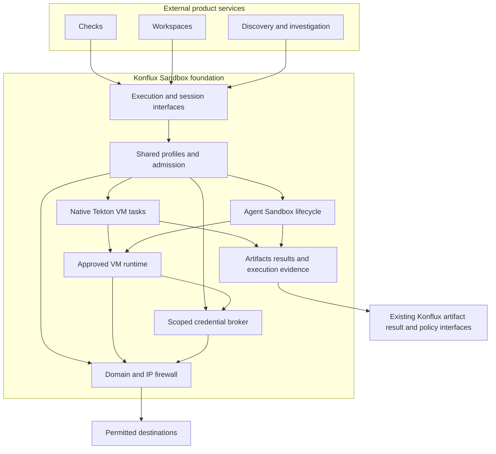

# Konflux Sandbox architecture

Konflux Sandbox supplies a shared execution foundation beside existing Konflux build, integration, and release workflows.
External services build workspaces, checks, and vulnerability workflows through its interfaces.
Those services own their product controllers and domain logic.

The [requirements](requirements.md) define the foundation scope and explicit domain and IP firewall contract.
The [implementation plan](implementation-plan.md) starts with a minimal immutable-source execution fixture.

## Architecture decisions

| Decision | Initial choice |
| --- | --- |
| Repository | github.com/p5/konflux-sandbox |
| Installation | Optional standalone extension |
| Controller language | Go with controller-runtime |
| Workflow engine | Existing Tekton PipelineRuns for finite stages |
| Execution backend | One Kubernetes adapter; Agent Sandbox is the initial candidate |
| Isolation | Existing VM runtime with profile conformance evidence |
| Outbound firewall | Trusted gateway plus outside packet fence; inspected HTTP/S domains and explicit IPv4 TCP grants |
| Durable state | Small Execution resource above native TaskRun and Agent Sandbox adapters |
| Execution identity | Scoped mTLS with external authorization and current guest UID binding |
| Runtime supervisor | Trusted allocation binding, local deadline enforcement, and disposal verification |
| Credential authority | Separate broker deployment and permissions |
| Artifact transport | OCI references and canonical source manifests |
| Result authority | Execution evidence; consumers decide verdict authority |
| Consumer promotion | Existing Konflux build and managed release workflows |

The [runtime experiment](experiments/004-runtime-lifecycle.md) demonstrated Agent Sandbox, Kata, direct Tekton execution, and OCI source consumption on this machine.
The first implementation can use native VM TaskRuns for finite checks and Agent Sandbox for sessions.
Both paths must use the same approved profiles, credential rules, artifact identity, and evidence contract.
Multiple runtime adapters follow demonstrated requirements.

## Validated execution choices

Native Tekton steps completed inside a real Kata guest and shared its guest kernel.
A composed TaskRun fetched a real OCI source artifact, verified its identity, restored source, and ran checks.
This path preserves ordinary TaskRun step and result mechanics.
It avoids a generic translator for arbitrary Tekton tasks in the first implementation.

The [dispatch experiment](experiments/005-dispatch-recovery.md) separately demonstrated a remote interface, structured results, and cancellation propagation.
Use that adapter when interactive execution or another runtime requires it.
Do not make remote dispatch mandatory for every finite check.

The shared execution module defines admission, profiles, source identity, broker grants, deadlines, and receipts.
It can submit native TaskRuns or manage session claims through adapters.
One contract does not require one new VM lifecycle engine or one HTTP call for every task step.

## Module responsibilities

The execution module owns admission, resolved identity, deadlines, cancellation, artifacts, and resource cleanup.
The backend adapter implements guest allocation and command transport.
It does not choose the workload's authority.

External product services use the execution interface.
The foundation keeps backend resource management, firewall enforcement, and credential policy behind that interface.

The broker owns upstream credentials and permitted external operations.
Its permissions remain separate from execution guests and the installation controller.

A trusted node supervisor owns allocation bindings, local deadlines, outside packet rules, and disposal observations.
It needs runtime privileges that consumer clients never receive.
Keep that authority separate from the credential broker and evidence readers.

## New and existing components

| Component | Implementation direction |
| --- | --- |
| Execution API, profiles, authorization, and lifecycle controller | New optional foundation component in this repository |
| Finite workflow execution | Reuse Tekton; add approved tasks and adapters |
| Session allocation and persistent files | Reuse Agent Sandbox; extend allocation binding and lifecycle interfaces where necessary |
| VM isolation | Reuse Kata or another approved provider; implement no hypervisor here |
| Node supervision and packet fence | New privileged component, or a supported runtime/CNI integration with equivalent guarantees |
| Domain gateway | New trusted service with explicit protocol capabilities |
| Credential broker | New service with separate credentials and operation authority |
| Private logs, artifacts, and signed receipts | New adapter over private storage; reuse existing signing interfaces where their authority fits |
| Workflow archive and diagnostics | Reuse Tekton Results; configure log storage separately |
| Build, Snapshot, integration, and managed release | Reuse Konflux through supported APIs and explicit promotion |
| Workspace, checks, and vulnerability products | External repositories consume the foundation API |

These additions can live in this separate repository and install beside existing Konflux workflows.
Existing Component, Snapshot, and Release schemas need no required field changes.
Runtime integration can require node privileges or provider changes without breaking existing Konflux resource APIs.

## Execution interface

The control interface supports request submission, status observation, cancellation, and output discovery.
Kubernetes resources provide durable request state.
Separate authenticated transports carry logs, file data, and interactive sessions.

The backend interface covers allocation, import, execution, export, cancellation, and destruction.
Keep runtime resource types behind that interface.
Advertise checkpoint capabilities separately from ordinary execution.

A request identifies:

- The immutable source and canonical source manifest.
- The approved command definition and environment.
- The selected profile and bounded resource request.
- The authenticated owner, request identifier, and deadline.

The controller records resolved configuration before dispatch.
An admitted request cannot change its inputs or authority.
Changes require a new request or an explicit new attempt.

The [consumer prototype](experiments/015-external-consumers.md) exposes capability discovery, immutable submission, observation, session commands, completion, and private evidence retrieval.
Two token-free clients use this interface without Kubernetes libraries, credentials, or backend templates.
The production API must add durable asynchronous operation state and versioned compatibility rules.

The status separates command outcome, infrastructure outcome, and cleanup conditions.
Logs and evidence live in bounded artifact storage.
Status fields contain references and short operational conditions.

## Execution recovery

Repeated reconciliation adopts the same owned child resources.
Cancellation is idempotent and propagates to all children.
Deletion requires cleanup or an explicit retained-resource condition.
An independent watchdog removes expired resources after lifecycle controller failure while the Kubernetes API remains available.
A runtime supervisor enforces local deadlines and allocation lease expiry without that API.
The runtime admission path must reject replacements whose execution authority expired.
A stopped CRI allocation alone cannot prove that kubelet will not create another allocation.
Persist allocation identity before untrusted code starts and keep cleanup finalizers until disposal is verified.
Bind runtime admission and execution identity to the provider allocation ID or generation as well as Pod UID.
Kubelet can replace a runtime allocation without changing that Pod UID.
The supervisor must account for every allocation generation associated with an attempt before it declares disposal complete.

Command dispatch has a failure window between execution and durable result recording.
The inspected Agent Sandbox command interface does not provide a client request token for deduplication.
If dispatch outcome is unknown, the controller records an unknown outcome.
It stops the attempt and requests cleanup.
A new attempt requires explicit retry policy and receives a new identity.

This contract avoids an unsupported exactly-once execution claim.
Publication operations also need their own idempotency and candidate identity rules.

## Execution profiles and authorization

Profiles belong to administrators or another explicitly delegated authority.
They specify runtime, environment selection, resource ceilings, network rules, output limits, retention, and broker operations.
Tenant input selects an authorized profile but cannot weaken its restrictions.

Enforce the profile at final resource creation and in the runtime network path.
Verify the runtime, service account, token projections, secret references, volumes, capabilities, and host access.
If required enforcement is unavailable, the profile cannot accept work.

Tenant roles cannot create or mutate native sandbox resources in execution namespaces.
The execution controller owns those resources.
Use separate roles for submission, observation, attachment, profile administration, and publication.

Workload profiles share the same implementation but differ in permitted actions.
Interactive development needs session access.
Checks need immutable input and independent results.
Confidential investigations need private evidence and stricter destination policy.

## Credentials and network access

The guest receives no long-lived upstream credentials or general Kubernetes API token.
If the transport requires a guest identity, scope it to that execution and its permitted operations.
Keep signing keys, repository write credentials, model credentials, and registry credentials outside guests.

The [identity prototype](experiments/012-identity-transport.md) binds mTLS certificates to owner, request, attempt, role, and actual guest UID.
The trusted gateway authorizes callers outside the guest and verifies the destination certificate before forwarding.
The broker checks both a scoped grant and the current guest binding.
Guest replacement invalidates the old binding even when its certificate remains cryptographically valid.
The prototype tests replacement with a new Pod UID.
Production identity must also distinguish runtime replacement within one Pod UID.
An opaque relay carries TLS bytes without credential or certificate authority.
The trusted gateway terminates TLS and can read commands and file data.
Production certificate enrollment must derive claims from authorized durable state rather than caller-selected certificate fields.

The broker authorizes operations against an execution identity and a revocable grant.
A grant names its owner, destination, action, deadline, and budget.
The broker validates destinations and redirects before credential injection.
Hostnames alone do not define adequate operation scope.

Network enforcement prevents direct access around the broker.
It also blocks metadata endpoints, unrelated private networks, and other executions.
Document any permitted artifact or control transport path explicitly.
Audit decisions outside the guest.

## Outbound firewall

The firewall is a required foundation capability.
It denies workload egress by default and permits approved domains, IP addresses, CIDR ranges, ports, and protocols.
It enforces resolved policy outside guests for both native TaskRuns and interactive sessions.
Consumers can request authorized restrictions or revocation through the foundation interface.
They cannot expand administrator permissions.

Domain policy needs controlled DNS, address expiry, rebinding protection, and explicit wildcard semantics.
The implementation must define hostname guarantees for shared IPs and each supported protocol.
It must block unauthorized direct IP access, alternate DNS, redirects, and unsupported protocol paths.
IPv6 needs equivalent enforcement or explicit disablement before admission.
Protected destination rules cover metadata, hosts, control-plane endpoints, unrelated tenants, and unrelated cluster services.

Policy readiness gates workload admission.
Install outside enforcement before any guest process handles untrusted source or application data.
Trusted bootstrap can establish identity and the narrow control transport before that barrier.
Enforcement failure stops affected network access.
Policy revocation must stop new connections and terminate established connections within a documented bound.
The audit record binds decisions to execution identity and policy revision.
Broker requests also need destination checks because a broker can otherwise bypass guest egress restrictions.

The [firewall prototype](experiments/011-firewall-enforcement.md) selected a trusted gateway plus an outside-guest packet fence.
Production needs a durable node agent or supported CNI adapter for interface binding, admission, disposal, and rule ownership.
The initial profile permits inspected HTTP/S domain traffic and explicit IPv4 TCP IP or CIDR grants.
HTTPS inspection requires client trust in the gateway CA and permits the gateway to read application data.
Opaque IP tunnels carry IP and port authority without an HTTP hostname guarantee.
UDP, IPv6 access, opaque domain tunnels, and unknown policy fields fail admission.
The fence rejects IPv6 traffic in both directions.
The local IPv6 baseline was unavailable; supported IPv6 access needs separate conformance evidence.
The gateway controls DNS, checks protected addresses after resolution, and opens fresh upstream connections.
Revocation closed tested active HTTP, HTTPS, and TCP streams within three seconds.
That local assertion does not establish a production latency guarantee.
Standard NetworkPolicy provides IP, Pod, namespace, and port controls; its API does not express domain allowlists.
Domain restrictions therefore need an additional enforcement implementation.
Standard NetworkPolicy also leaves the effect of policy changes on established connections to its enforcement implementation.
Source: [Kubernetes NetworkPolicy](https://kubernetes.io/docs/concepts/services-networking/network-policies/).

The suite exercised ordinary containers, real Kata sessions, and native Kata TaskRuns.
It tested shared addresses, DNS changes, rebinding, unauthorized resolvers, redirects, hostname mismatch, and direct connection attempts.
The outside fence remained active after gateway deletion and until verified guest disposal.
Production conformance must cover each supported CNI, routing mode, runtime, and protocol.
The [broker composition](experiments/016-broker-network.md) applies the destination profile to broker-originated operations through a separately fenced gateway.
Grant permission and profile permission must both allow the destination before the broker injects credentials.

## Storage limits

The [storage experiment](experiments/018-guest-storage-limits.md) found that both memory and disk emptyDir settings allowed writes beyond sizeLimit inside Kata.
An explicit guest tmpfs imposed the requested volume limit.
Capability removal alone still allowed an unprivileged namespace to mount another filesystem.
The filtered launcher blocked that tested bypass after trusted bootstrap and privilege drop.

Profiles must specify actual runtime and volume guarantees rather than infer hard quotas from Kubernetes resource fields.
Require a read-only root and bounded writable paths.
Include shared memory, artifact staging, task workspaces, persistent volumes, and restore paths in conformance.
Guest filesystem enforcement depends on the guest kernel.
Guest root or kernel compromise requires storage ceilings outside that guest, such as provider disk capacity or host filesystem quotas.
Persistent volume quota enforcement remains implementation work.
The experimental Linux AMD64 syscall filter is not a complete production policy.

## Source artifacts and evidence

A source archive represents selected bytes and filesystem metadata.
Its canonical manifest defines paths, file modes, symlink handling, and included files.
A Git revision remains contextual unless the extension verifies the exact source relationship.

Import and export enforce path confinement and resource limits.
A valid digest establishes identity but does not make content safe.
Run source scripts and target programs inside the guest.

An execution receipt binds these identities:

- Request, attempt, owner, and guest instance.
- Source manifest and command definition.
- Environment images and relevant dependencies.
- Resolved profile, backend, runtime, and policy revision.
- Start time, end time, outcome, output digests, and cleanup conditions.

Separate supervisor-observed metadata from guest-reported output.
State which enforcement facts the receipt actually supports.
Use existing signing infrastructure where its trust and predicate formats fit.

A signed dispatch TaskRun establishes dispatcher identity.
Remote workload identity needs additional execution evidence.
Do not claim that a requested profile alone proves enforcement.

Private findings, patches, reproducers, source, and model traces require private storage and access controls.
Public publication occurs through a separate authorized operation.

The [private evidence prototype](experiments/014-private-evidence.md) demonstrates owner-scoped HTTPS access, bounded output, immutable artifacts, and fixed retention.
A trusted supervisor signs receipts; the store and clients verify them with separately supplied public keys.
The consumer composition keeps evidence available after guest and execution namespace removal.
These fixtures hold evidence in memory and retain ignored local captures after API retention expires.
Production storage must define durable retention, backups, access revocation, and deletion of managed copies.

## Konflux compatibility

The first installation adds controllers, resources, tasks, and execution profiles.
It does not change required fields in existing Component, Snapshot, or Release resources.
Existing pipeline credentials and execution behavior remain on their current paths.

The first execution fixture uses a versioned native Tekton task and an approved VM RuntimeClass.
Its contract covers one supported command shape.
Remote dispatch needs a separate adapter when a workload requires another execution service.
Any broader task support needs compatibility evidence for steps, sidecars, workspaces, and result files.

Exploratory runs use distinct workflow definitions and labels.
They do not claim to be normal signed builds or produce release Snapshots automatically.
Approved candidates enter the normal build path through verified source publication.

Trusted Artifact policy needs an explicit source-import producer contract.
Consumers own any authoritative verdict reuse and define its equivalence, freshness, and issuer rules.
Shared execution across existing pipelines follows an optional migration with versioned tasks.

## Deferred capabilities

- Full VM memory and process restoration.
- Shared warm snapshots and dependency state.
- Automatic reuse of before-push verdicts at merge or release.
- Arbitrary Tekton TaskSpec translation.
- Multiple runtime backends and remote architectures.
- Konflux operator installation and built-in UI integration.

Each capability follows evidence for the relevant execution contract.

## Source references

The following commit references record the code baseline from 14 October 2026.
They provide design evidence, not a supported dependency matrix.

- [Agent Sandbox lifecycle and runtime scope](https://github.com/kubernetes-sigs/agent-sandbox/tree/5d7608a9fca5aa1d3a12b73fb51ed2ee0d4e9ab1).
- [Agent Sandbox transport options](https://github.com/kubernetes-sigs/agent-sandbox/blob/5d7608a9fca5aa1d3a12b73fb51ed2ee0d4e9ab1/clients/go/sandbox/options.go).
- [Agent Sandbox command semantics](https://github.com/kubernetes-sigs/agent-sandbox/blob/5d7608a9fca5aa1d3a12b73fb51ed2ee0d4e9ab1/clients/go/sandbox/commands.go).
- [Agent Sandbox process protocol](https://github.com/kubernetes-sigs/agent-sandbox/blob/5d7608a9fca5aa1d3a12b73fb51ed2ee0d4e9ab1/packages/sandboxd/spec/process/v1/process.proto).
- [Agent Sandbox suspend behavior](https://github.com/kubernetes-sigs/agent-sandbox/blob/5d7608a9fca5aa1d3a12b73fb51ed2ee0d4e9ab1/controllers/sandbox_controller.go#L1328).
- [Konflux generalized artifacts ADR](https://github.com/konflux-ci/architecture/blob/a51babeeae47f69f4cba98505b4d5dd66a2c73a6/ADR/0063-generalized-build-release-pipelines.md).
- [Konflux build source trigger](https://github.com/konflux-ci/build-service/blob/ab6a21c3186fef99888269756ae8c36ad0155b38/internal/controller/component_build_controller_pac.go#L330).
- [Konflux build credential linkage](https://github.com/konflux-ci/build-service/blob/ab6a21c3186fef99888269756ae8c36ad0155b38/internal/controller/component_build_controller_service_account.go#L201).
- [Tekton Pod templates](https://tekton.dev/docs/pipelines/podtemplates/).
- [Chainguard shared sandbox architecture](https://main.chainguard.dev.chainguard.app/unchained/this-shit-is-hard-how-chainguard-is-sandboxing-athena).
