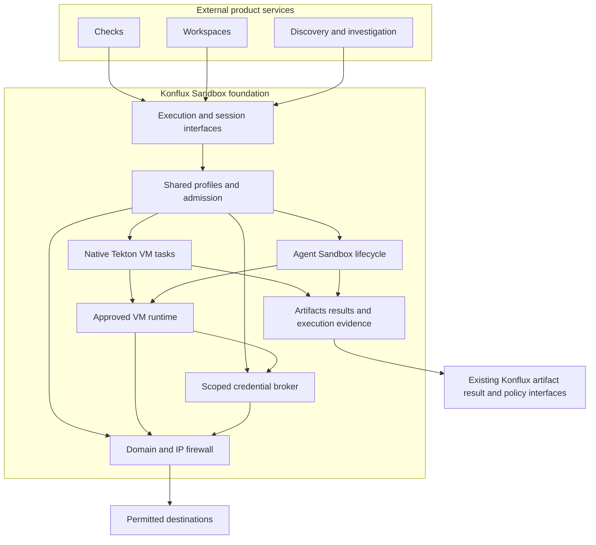

# Konflux Sandbox architecture

Konflux Sandbox supplies a shared execution foundation beside existing Konflux build, integration, and release workflows.
External services build workspaces, checks, and vulnerability workflows through its interfaces.
Those services own their product controllers and domain logic.

The [requirements](requirements.md) define the foundation scope and explicit domain and IP firewall contract.
The [implementation plan](implementation-plan.md) starts with a minimal immutable-source execution fixture.

## Architecture decisions

| Decision | Initial choice |
| --- | --- |
| Repository | github.com/p5/konflux-sandbox |
| Installation | Optional standalone extension |
| Controller language | Go with controller-runtime |
| Workflow engine | Existing Tekton PipelineRuns for finite stages |
| Execution backend | One Kubernetes adapter; Agent Sandbox is the initial candidate |
| Isolation | Existing VM runtime with profile conformance evidence |
| Outbound firewall | Default denial with domain, IP, CIDR, port, and protocol allowlists outside guests |
| Credential authority | Separate broker deployment and permissions |
| Artifact transport | OCI references and canonical source manifests |
| Result authority | Execution evidence; consumers decide verdict authority |
| Consumer promotion | Existing Konflux build and managed release workflows |

The [runtime experiment](experiments/004-runtime-lifecycle.md) demonstrated Agent Sandbox, Kata, direct Tekton execution, and OCI source consumption on this machine.
The first implementation can use native VM TaskRuns for finite checks and Agent Sandbox for sessions.
Both paths must use the same approved profiles, credential rules, artifact identity, and evidence contract.
Multiple runtime adapters follow demonstrated requirements.

## Validated execution choices

Native Tekton steps completed inside a real Kata guest and shared its guest kernel.
A composed TaskRun fetched a real OCI source artifact, verified its identity, restored source, and ran checks.
This path preserves ordinary TaskRun step and result mechanics.
It avoids a generic translator for arbitrary Tekton tasks in the first implementation.

The [dispatch experiment](experiments/005-dispatch-recovery.md) separately demonstrated a remote interface, structured results, and cancellation propagation.
Use that adapter when interactive execution or another runtime requires it.
Do not make remote dispatch mandatory for every finite check.

The shared execution module defines admission, profiles, source identity, broker grants, deadlines, and receipts.
It can submit native TaskRuns or manage session claims through adapters.
One contract does not require one new VM lifecycle engine or one HTTP call for every task step.

## Module responsibilities

The execution module owns admission, resolved identity, deadlines, cancellation, artifacts, and resource cleanup.
The backend adapter implements guest allocation and command transport.
It does not choose the workload's authority.

External product services use the execution interface.
The foundation keeps backend resource management, firewall enforcement, and credential policy behind that interface.

The broker owns upstream credentials and permitted external operations.
Its permissions remain separate from execution guests and the installation controller.

## Execution interface

The control interface supports request submission, status observation, cancellation, and output discovery.
Kubernetes resources provide durable request state.
Separate authenticated transports carry logs, file data, and interactive sessions.

The backend interface covers allocation, import, execution, export, cancellation, and destruction.
Keep runtime resource types behind that interface.
Advertise checkpoint capabilities separately from ordinary execution.

A request identifies:

- The immutable source and canonical source manifest.
- The approved command definition and environment.
- The selected profile and bounded resource request.
- The authenticated owner, request identifier, and deadline.

The controller records resolved configuration before dispatch.
An admitted request cannot change its inputs or authority.
Changes require a new request or an explicit new attempt.

The status separates command outcome, infrastructure outcome, and cleanup conditions.
Logs and evidence live in bounded artifact storage.
Status fields contain references and short operational conditions.

## Execution recovery

Repeated reconciliation adopts the same owned child resources.
Cancellation is idempotent and propagates to all children.
Deletion requires cleanup or an explicit retained-resource condition.
An orphan reconciler removes expired resources after controller failure.

Command dispatch has a failure window between execution and durable result recording.
The inspected Agent Sandbox command interface does not provide a client request token for deduplication.
If dispatch outcome is unknown, the controller records an unknown outcome.
It stops the attempt and requests cleanup.
A new attempt requires explicit retry policy and receives a new identity.

This contract avoids an unsupported exactly-once execution claim.
Publication operations also need their own idempotency and candidate identity rules.

## Execution profiles and authorization

Profiles belong to administrators or another explicitly delegated authority.
They specify runtime, environment selection, resource ceilings, network rules, output limits, retention, and broker operations.
Tenant input selects an authorized profile but cannot weaken its restrictions.

Enforce the profile at final resource creation and in the runtime network path.
Verify the runtime, service account, token projections, secret references, volumes, capabilities, and host access.
If required enforcement is unavailable, the profile cannot accept work.

Tenant roles cannot create or mutate native sandbox resources in execution namespaces.
The execution controller owns those resources.
Use separate roles for submission, observation, attachment, profile administration, and publication.

Workload profiles share the same implementation but differ in permitted actions.
Interactive development needs session access.
Checks need immutable input and independent results.
Confidential investigations need private evidence and stricter destination policy.

## Credentials and network access

The guest receives no long-lived upstream credentials or general Kubernetes API token.
If the transport requires a guest identity, scope it to that execution and its permitted operations.
Keep signing keys, repository write credentials, model credentials, and registry credentials outside guests.

The broker authorizes operations against an execution identity and a revocable grant.
A grant names its owner, destination, action, deadline, and budget.
The broker validates destinations and redirects before credential injection.
Hostnames alone do not define adequate operation scope.

Network enforcement prevents direct access around the broker.
It also blocks metadata endpoints, unrelated private networks, and other executions.
Document any permitted artifact or control transport path explicitly.
Audit decisions outside the guest.

## Outbound firewall

The firewall is a required foundation capability.
It denies workload egress by default and permits approved domains, IP addresses, CIDR ranges, ports, and protocols.
It enforces resolved policy outside guests for both native TaskRuns and interactive sessions.
Consumers can request authorized restrictions or revocation through the foundation interface.
They cannot expand administrator permissions.

Domain policy needs controlled DNS, address expiry, rebinding protection, and explicit wildcard semantics.
The implementation must define hostname guarantees for shared IPs and each supported protocol.
It must block unauthorized direct IP access, alternate DNS, redirects, and unsupported protocol paths.
IPv6 needs equivalent enforcement or explicit disablement before admission.
Protected destination rules cover metadata, hosts, control-plane endpoints, unrelated tenants, and unrelated cluster services.

Policy readiness gates workload admission.
Enforcement failure stops affected network access.
Policy revocation must stop new connections and terminate established connections within a documented bound.
The audit record binds decisions to execution identity and policy revision.
Broker requests also need destination checks because a broker can otherwise bypass guest egress restrictions.

The firewall implementation remains an open design decision.
Standard NetworkPolicy provides IP, Pod, namespace, and port controls; its API does not express domain allowlists.
Domain restrictions therefore need an additional enforcement implementation.
Standard NetworkPolicy also leaves the effect of policy changes on established connections to its enforcement implementation.
Source: [Kubernetes NetworkPolicy](https://kubernetes.io/docs/concepts/services-networking/network-policies/).

Existing experiments demonstrated one direct Pod IP restriction with KindNet.
They did not demonstrate domain filtering, rebinding protection, IPv6 restrictions, or complete bypass prevention.
The first foundation release requires separate firewall conformance evidence.

## Source artifacts and evidence

A source archive represents selected bytes and filesystem metadata.
Its canonical manifest defines paths, file modes, symlink handling, and included files.
A Git revision remains contextual unless the extension verifies the exact source relationship.

Import and export enforce path confinement and resource limits.
A valid digest establishes identity but does not make content safe.
Run source scripts and target programs inside the guest.

An execution receipt binds these identities:

- Request, attempt, owner, and guest instance.
- Source manifest and command definition.
- Environment images and relevant dependencies.
- Resolved profile, backend, runtime, and policy revision.
- Start time, end time, outcome, output digests, and cleanup conditions.

Separate supervisor-observed metadata from guest-reported output.
State which enforcement facts the receipt actually supports.
Use existing signing infrastructure where its trust and predicate formats fit.

A signed dispatch TaskRun establishes dispatcher identity.
Remote workload identity needs additional execution evidence.
Do not claim that a requested profile alone proves enforcement.

Private findings, patches, reproducers, source, and model traces require private storage and access controls.
Public publication occurs through a separate authorized operation.

## Konflux compatibility

The first installation adds controllers, resources, tasks, and execution profiles.
It does not change required fields in existing Component, Snapshot, or Release resources.
Existing pipeline credentials and execution behavior remain on their current paths.

The first execution fixture uses a versioned native Tekton task and an approved VM RuntimeClass.
Its contract covers one supported command shape.
Remote dispatch needs a separate adapter when a workload requires another execution service.
Any broader task support needs compatibility evidence for steps, sidecars, workspaces, and result files.

Exploratory runs use distinct workflow definitions and labels.
They do not claim to be normal signed builds or produce release Snapshots automatically.
Approved candidates enter the normal build path through verified source publication.

Trusted Artifact policy needs an explicit source-import producer contract.
Consumers own any authoritative verdict reuse and define its equivalence, freshness, and issuer rules.
Shared execution across existing pipelines follows an optional migration with versioned tasks.

## Deferred capabilities

- Full VM memory and process restoration.
- Shared warm snapshots and dependency state.
- Automatic reuse of before-push verdicts at merge or release.
- Arbitrary Tekton TaskSpec translation.
- Multiple runtime backends and remote architectures.
- Konflux operator installation and built-in UI integration.

Each capability follows evidence for the relevant execution contract.

## Source references

The following commit references record the code baseline from 14 October 2026.
They provide design evidence, not a supported dependency matrix.

- [Agent Sandbox lifecycle and runtime scope](https://github.com/kubernetes-sigs/agent-sandbox/tree/5d7608a9fca5aa1d3a12b73fb51ed2ee0d4e9ab1).
- [Agent Sandbox transport options](https://github.com/kubernetes-sigs/agent-sandbox/blob/5d7608a9fca5aa1d3a12b73fb51ed2ee0d4e9ab1/clients/go/sandbox/options.go).
- [Agent Sandbox command semantics](https://github.com/kubernetes-sigs/agent-sandbox/blob/5d7608a9fca5aa1d3a12b73fb51ed2ee0d4e9ab1/clients/go/sandbox/commands.go).
- [Agent Sandbox process protocol](https://github.com/kubernetes-sigs/agent-sandbox/blob/5d7608a9fca5aa1d3a12b73fb51ed2ee0d4e9ab1/packages/sandboxd/spec/process/v1/process.proto).
- [Agent Sandbox suspend behavior](https://github.com/kubernetes-sigs/agent-sandbox/blob/5d7608a9fca5aa1d3a12b73fb51ed2ee0d4e9ab1/controllers/sandbox_controller.go#L1328).
- [Konflux generalized artifacts ADR](https://github.com/konflux-ci/architecture/blob/a51babeeae47f69f4cba98505b4d5dd66a2c73a6/ADR/0063-generalized-build-release-pipelines.md).
- [Konflux build source trigger](https://github.com/konflux-ci/build-service/blob/ab6a21c3186fef99888269756ae8c36ad0155b38/internal/controller/component_build_controller_pac.go#L330).
- [Konflux build credential linkage](https://github.com/konflux-ci/build-service/blob/ab6a21c3186fef99888269756ae8c36ad0155b38/internal/controller/component_build_controller_service_account.go#L201).
- [Tekton Pod templates](https://tekton.dev/docs/pipelines/podtemplates/).
- [Chainguard shared sandbox architecture](https://main.chainguard.dev.chainguard.app/unchained/this-shit-is-hard-how-chainguard-is-sandboxing-athena).
