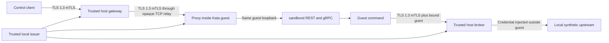

# Execution identity, encrypted transport, and broker access

Date: 2026-10-14.

## Result

Real Kata guests used scoped x509 identities for command access and broker operations.
The experiment transferred files and streamed commands through authenticated TLS.
It rejected another owner, another attempt, an expired identity, a revoked grant, and a replaced guest identity.

The issuer, authorization gateway, credential broker, and synthetic upstream ran outside the guests.
One guest ran at a time. Each guest had a 512 MiB container memory limit.

## Executed topology



The host cannot directly route to this cluster's Pod IPs.
An ordinary-container TCP relay and a namespace-local NodePort Service carried opaque TLS bytes to the guest.
The relay had no certificate keys or credential authority.
The gateway checked the guest certificate's DNS name, URI identity, role, and CA chain.
The relay therefore did not terminate encryption or establish guest identity.

TLS terminated inside the actual guest before reaching sandboxd on `127.0.0.1`.
The inspected sandboxd version has no TLS listener.
Its loopback REST and gRPC listeners were not exposed directly on the Pod network.

The trusted gateway separately authorized control requests before forwarding them.
Authorization did not depend only on checks inside the guest.
The gateway also terminated the client's TLS connection, so it could read commands and file data.
This is encrypted transport across network boundaries, with an explicitly trusted gateway.
It is not client-to-guest encryption that hides data from that gateway.

## Identity contract

The local issuer generated an Ed25519 CA and short-lived x509 leaf certificates.
Normal fixture leaves lasted five minutes.
A separate one-second certificate tested expiry.

Each execution identity used this URI SAN:

```text
spiffe://konflux-sandbox.prototype/owner/alice/request/check-1/attempt/attempt-1/guest/POD_UID
```

The UID came from the actual Kubernetes Pod.
The certificate's organizational unit distinguished control, execution, and server roles.
The gateway and broker parsed those claims only after TLS chain validation.
The role check prevented an execution credential from authorizing external control access.

The CA private key remained in host-side ignored storage.
The guest received its server leaf key, execution leaf key, and public CA.
Control credentials, issuer keys, and the upstream credential stayed outside it.
The guest received no Kubernetes API token.

Guest bootstrap used the existing authenticated Kubernetes exec channel.
That operation copied only the intended leaf material and started the two guest daemons.
This prototype trusts the local Kubernetes administrator and the host issuer.
It does not implement an enrollment service or hardware attestation.

## Observed scenarios

| Scenario | Required result |
|---|---|
| No client certificate | TLS handshake rejection |
| Execution-role certificate on control interface | HTTP 403 |
| Valid owner with wrong guest server name | HTTP 502 with x509 name mismatch |
| Authorized file upload and download | Original bytes restored |
| Streaming command through HTTP/2 | First output observed before command completion |
| Another owner's control certificate | HTTP 403 before forwarding |
| Another attempt's control certificate | HTTP 403 before forwarding |
| Active control authorization revoked | Command stream interrupted within three seconds |
| Actual guest execution certificate and matching grant | Broker returns fixture result |
| Another owner's broker certificate | HTTP 403 |
| Another attempt's broker certificate | HTTP 403 |
| Expired certificate | TLS certificate-expiry rejection |
| Active broker grant revoked | Actual upstream stream cancelled within three seconds |
| Revoked grant reused | HTTP 403 |
| Guest replaced while old grant remains unrevoked | Old execution identity rejected with HTTP 403 |
| Old control identity after replacement | HTTP 403 |
| New identity and new grant | Fresh guest reconnect and broker request succeed |

The command executed `uname -r` inside the guest.
The reported guest kernel differed from the Kind node kernel.
Guest output is still workload output, rather than independent runtime attestation.

The broker test waited for actual response chunks before revocation.
The external fixture upstream recorded cancellation of its active request.
The returned stream contained fewer chunks than the complete fixture response.

Replacement deleted the old Pod before creating its successor.
The host updated the active execution binding to the new UID.
The old leaf certificate remained cryptographically valid, and its original grant was explicitly unrevoked.
The broker still denied it because it no longer matched the active guest binding.

The gateway reloaded its destination and expected server identity before reconnecting.
The new guest received a distinct server certificate and execution certificate.
Successful file transfer and broker access then used the new UID.

## Broker authority

The external broker required a valid execution certificate and a separately defined grant.
The grant bound owner, request, attempt, guest UID, action, and expiry.
The active execution registry also had to match.
The broker checked identity expiry and grant validity during active requests.

Its upstream was a fixed local fixture server.
The broker generated a random synthetic credential at runtime and injected it into upstream requests.
The shared guest binary contained no copy of that generated value.
Guest bootstrap files and returned data contained no copy of it.

The guest could request the permitted operation but could not select an upstream destination or credential.
This fixture does not implement a general model or repository proxy.
Redirect policy, provider accounting, durable grant storage, and provider federation remain separate work.

## Reuse

The [fixture README](../../prototypes/identity/README.md) defines the reusable Go package and command interfaces.
The private-evidence prototype imports the same identity parser.
Consumers must verify certificate chains before parsing identity claims.

Host-side route and grant files are trusted fixture inputs.
They model authority that a production execution controller must maintain.
Caller-provided headers identify requested routes and grants; they do not establish identity.

The certificate utility is a trusted local command.
It accepts claims supplied by its caller and does not authorize that caller.
Expose certificate issuance only behind a separately authorized controller or enrollment service.

## Remaining limits

- The experiment did not install a composed deny-by-default egress profile.
- Broker and control destinations need explicit network exceptions in the firewall composition.
- The guest controls its leaf keys and can use its current permitted operations.
- Revocation stops the control stream. That alone does not prove every guest child process stopped.
- Pod deletion performed final guest cleanup.
- The gateway and broker reload local files rather than durable Kubernetes resource state.
- Certificate renewal, CA rotation, clock skew, and issuer recovery were not exercised.
- TLS protects traffic on the network. It does not protect data from the trusted gateway or guest.
- No provider credential, model request, GitHub action, or external publication was involved.

These limits do not change the observed identity and transport results.
They define the next composition and controller responsibilities.

## Versions and reproduction

The experiment reused the runtime environment from [experiment 004](004-runtime-lifecycle.md).
It used Kata `4.2.0`, Kubernetes `v1.37.0`, containerd `2.3.4`, and the pinned sandboxd source.
The identity fixture targeted Go `1.26` and used `golang.org/x/net v0.59.0` for HTTP/2.
The installed build toolchain was Go `1.27.2`.

First install the runtime prototype's VM cluster and execution image.
Then run:

```sh
make -C prototypes/identity run
```

The scripts enforce the dedicated VM context and compare its API endpoint with local Kind inventory.
They use namespace `foundation-identity-prototype` and an automatically allocated NodePort.
The suite removes both guest incarnations, relay Pods, the Service, and host servers through its exit handler.
The namespace and ignored local issuer state remain for inspection.

Captures are under `prototypes/identity/evidence/`.
Private keys and temporary configuration are under `prototypes/identity/.state/`.
Neither directory belongs in Git.

Remove the retained namespace with:

```sh
make -C prototypes/identity cleanup
```

## Source references

- [sandboxd transport and authentication contract](https://github.com/kubernetes-sigs/agent-sandbox/blob/5d7608a9fca5aa1d3a12b73fb51ed2ee0d4e9ab1/packages/sandboxd/USER_GUIDE.md)
- [sandboxd streaming process API](https://github.com/kubernetes-sigs/agent-sandbox/blob/5d7608a9fca5aa1d3a12b73fb51ed2ee0d4e9ab1/packages/sandboxd/spec/process/v1/process.proto)
- [Go TLS client certificate verification](https://pkg.go.dev/crypto/tls#ClientAuthType)
- [Go HTTP/2 transport](https://pkg.go.dev/golang.org/x/net/http2#Transport)
