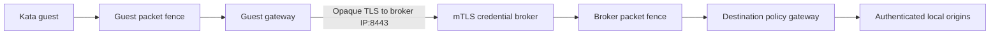

# Experiment 016: broker destination enforcement

## Question

Can an authenticated Kata guest use a scoped credential broker while external firewall rules also restrict broker-originated requests?

## Method

Run `make -C prototypes/broker-network run`.
The suite uses the dedicated `kind-konflux-sandbox-vm-prototype` cluster and a private kubeconfig.
It creates only `foundation-broker-network-prototype`.
One Kata guest has a 512 MiB memory limit.
A token-free ordinary broker Pod and two gateways run outside that guest.
All DNS records, origins, certificates, and credentials remain local.

The fixture reuses the shared [identity issuer](../../prototypes/identity/pki/identity.go) and [firewall implementation](../../prototypes/firewall/gateway.go).
The shared [fence helper](../../prototypes/firewall/fence.sh) binds enforcement to actual Pod, CRI, and QEMU identities.
The [broker implementation](../../prototypes/broker-network/main.go) and [runner](../../prototypes/broker-network/run.sh) supply the composition.

The guest gateway permits only an explicit broker IP and TCP port.
The broker authenticates the actual guest Pod UID through a short-lived execution certificate.
Its grant binds that identity, operation aliases, action, profile digest, deadline, and operation budget.
The caller cannot supply an upstream URL or credential.
The broker injects a random synthetic credential outside the guest.
The egress gateway separately enforces domain, port, protected-address, and DNS rules.

The broker's fence permits only its egress gateway and replies to the guest gateway's incoming TLS connections.
The guest's fence permits only its guest gateway.
Both fences reject IPv6.
Trusted Kubernetes port-forward sessions provide loopback administration and fixture observations.
Guests receive no administration endpoint, issuer key, upstream secret, or Kubernetes token.

## Observed results

The complete Make target passed on 14 October 2026.
The guest reported kernel `6.18.35`, which differed from the node kernel.

| Scenario | Observed result |
|---|---|
| Permitted HTTP operation | HTTP 200; origin confirms injected credential |
| Permitted inspected HTTPS operation | HTTP 200; origin confirms injected credential |
| Destination outside operation grant | HTTP 403; no origin request |
| Wrong operation or profile identity | HTTP 403; no origin request |
| Grant-permitted destination outside firewall profile | HTTP 403; forbidden origin receives no request |
| Origin redirects to another hostname | HTTP 502; redirect target receives no request |
| Approved name initially resolves to fixture origin | HTTP 200 |
| Same name rebinds to node or gateway IP | HTTP 403 after DNS resolution |
| Approved name resolves to protected node IP | HTTP 403 after DNS resolution |
| Direct guest connection to origin or broker | Reachable before fence; blocked afterward |
| Direct broker connection to origin | Reachable before fence; blocked afterward |
| Grant revocation during actual upstream stream | Client stream closes in 11 ms; new operation returns HTTP 410 |
| Profile revocation during actual upstream stream | Client stream closes in 13 ms; new operation returns HTTP 403 |
| Broker egress gateway deletion | Broker returns HTTP 502; direct origin bypass stays blocked |
| Guest gateway deletion | Client cannot connect; direct broker bypass stays blocked |
| Namespace and workload removal | Recorded guest and broker allocations disappear before fence removal |

The origin independently recorded two cancelled streams.
It accepted six credential-bearing requests across the permitted operation paths.
Forbidden and redirected target hostnames received zero requests.
No captured response or audit file contained the synthetic upstream credential value.

The first complete network run found an error-reporting gap after gateway deletion.
An unbounded broker dial outlasted the client's twelve-second timeout.
The broker now uses three-second dial and TLS limits, plus an eight-second operation context.
The repeated full Make target returned the expected structured HTTP 502.

## Decision

Apply the resolved destination profile to broker egress as well as workload egress.
An operation grant alone does not establish network permission.
An explicit broker endpoint exception must carry authenticated, scoped operations.
It must not permit a guest to bypass the broker or select arbitrary destinations.

Keep broker and profile revocation independent.
Both must stop active upstream work and reject new work.
Observe credential acceptance and cancellation at the origin, not only at the caller.

The trusted egress gateway can read credential-bearing HTTP and inspected HTTPS.
It belongs inside the credential trust boundary.
A production adapter must disclose that requirement through its protocol capabilities.

## Limits and remaining work

This is a small architectural fixture with one guest and one broker.
Enrollment, grant configuration, and administration trust the local controller.
The suite does not implement provider federation, provider cost accounting, durable grant recovery, or multi-tenant broker admission.
The earlier [broker experiment](006-broker-grants.md) separately tests operation budgets, budget races, and expired grants.
This composition establishes real TLS identity and destination enforcement together.

The local three-second revocation assertion is not a production latency guarantee.
Network audit uses gateway decisions and fixture counters.
It does not establish complete kernel-level traffic audit coverage.
Production still needs supported network adapters and durable enforcement ownership.

## Captures and cleanup

Generated captures stay in ignored `prototypes/broker-network/evidence/`.
Private state stays in ignored `.state/` and `.build/` directories beside the prototype.
The summary records the actual guest UID and profile digest.
Origin counters, gateway audits, broker audit, and final fence records support the assertions.

Successful cleanup removes the owned namespace and verifies each recorded runtime allocation before removing its fence.
The final fence records contain `removed=true` and `runtimeRemovalVerified=true`.
Cleanup retains a fence when allocation disposal cannot be verified.
No unrelated namespace, cluster setting, provider credential, or host service changes.
